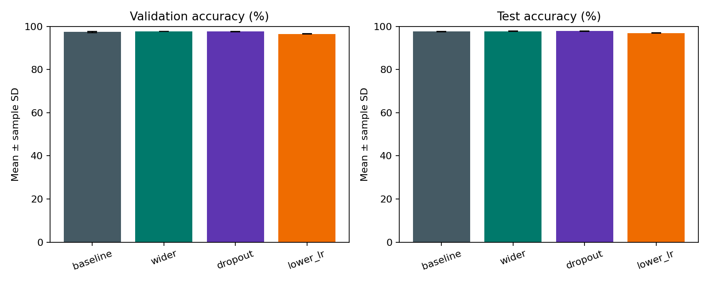

# MNIST • MLP ile El Yazısı Rakam Tanıma

**İrem Nur Sabırlı — İstanbul Medeniyet Üniversitesi**

PyTorch ile sıfırdan eğitilen, yalnızca tam bağlantılı katmanlar kullanan MLP projesi. Dört yapılandırma, üç başlangıç tohumu ve birbirinden ayrı train/validation/test kümeleri içerir.

> **Teslim durumu:** MNIST ve gerçek el yazısı deneyleri tamamlanmıştır. Sağlanan fotoğraftaki `22120606015` numarası 11/11 doğru tanınmıştır. GitHub’a yükleme ve öğrenci tarafından son kontrol beklenmektedir.

## Hızlı erişim

- [Deney raporu ve gerçek sonuçlar](results/main/RAPOR.md)
- [Model seçimi](results/main/selection.json)
- [Tüm ölçümler](results/main/results.csv)
- [Gerçek el yazısı sonuçları](results/handwriting/handwriting_report.md)
- [El yazısı görselleri ve tekrar üretim](handwriting/README.md)
- [Projeyi anlama ve sunuma hazırlık](docs/SUNUMA_HAZIRLIK.md)
- [GitHub teslim adımları](docs/TESLIM.md)
- [Jupyter / Colab çalışma defteri](MNIST_MLP.ipynb)



## 1. Kurulum

Python 3.12 ile test edilmiştir. Terminali bu README'nin bulunduğu proje klasöründe açın.

```bash
python -m venv .venv
```

Windows PowerShell: `.venv\Scripts\Activate.ps1`  
macOS / Linux: `source .venv/bin/activate`

CPU kurulumu:

```bash
python -m pip install torch==2.15.0 --index-url https://download.pytorch.org/whl/cpu
python -m pip install -r requirements.txt
python -m unittest discover -s tests -v
```

GPU zorunlu değildir. Paket sürümleri gerçek çalıştırma ortamında kullanılan sürümlerdir. Colab'da mevcut PyTorch ile çalışılabilir; tam tekrar için ortam sürümlerini kontrol edin. GPU kurulumunda cihazınıza uygun PyTorch dağıtımını kullanın.

## 2. Sıfırdan yeniden eğitim

```bash
python -m src.train --output results/my_run
python -m src.report --results results/my_run
```

İlk çalıştırmada resmî MNIST arşivi otomatik indirilir. İnternet bağlantısı gerekir. Mevcut sonuçların üzerine yazılmaz; yeni bir klasör adı kullanın. Çıktılar mevcut `results/main` deneyinden bağımsızdır. Varsayılan CPU, 2 thread; GPU kullanımı için `--device cuda` seçeneği vardır.

- **Train:** 50.000, ağırlık güncellemeleri için.
- **Validation:** 10.000, epoch ve yapılandırma seçimi için.
- **Test:** Resmî ayrı 10.000, seçim dondurulduktan sonra nihai ölçüm için.
- **Girdi:** 28×28 → 784; normalizasyon: piksel/255.
- **Temel mimari:** 784 → 128 → 64 → 10; ReLU.
- **Kayıp:** CrossEntropyLoss; çıkışta eğitim sırasında softmax yok.
- **Optimizasyon:** Adam, 12 epoch, batch=128.
- **Karşılaştırmalar:** gizli katman genişliği, dropout, öğrenme oranı. Her biri temel modele göre tek faktörü değiştirir.
- **Tekrarlar:** 42, 123, 2026 tohumları. Bölünme her koşuda aynı.

`best.pt` dosyaları bu projede MNIST üzerinde sıfırdan eğitilmiştir. Eğitim komutu bunları başlangıç ağırlığı olarak yüklemez; her koşuda yeni model oluşturur.

## 3. Gerçek el yazısı deneyi ve tekrar üretim

Orijinal öğrenci fotoğrafı, 11 kırpım, etiketler ve sonuçlar pakete eklenmiştir. Görselden okunan ve modelin tahmin ettiği numara `22120606015`tir. Rakam doğruluğu %100 (11/11), tam numara eşleşmesi başarılıdır. Tek fotoğrafta yalnızca beş rakam sınıfı bulunduğundan bu değer genel gerçek dünya performansı olarak yorumlanmamalıdır.

Kırpımları özgün fotoğraftan yeniden üretmek için `python -m src.prepare_handwriting` çalıştırılabilir. Başka bir fotoğraf için mevcut koordinatlar kullanılamaz; [el yazısı yönergesini](handwriting/README.md) izleyin.

Önce `results/main/selection.json` içindeki `checkpoint` değerine bakın. Aşağıdaki komut bu yolu otomatik okur:

```bash
python -c "import json,subprocess,sys; s=json.load(open('results/main/selection.json')); subprocess.run([sys.executable,'-m','src.handwriting','--checkpoint','results/main/'+s['checkpoint'],'--output','results/handwriting_repeat'],check=True)"
```

Paketin tamamlanmış çıktıları `results/handwriting/` içindedir: `predictions.json`, `predictions.png`, tekil 28×28 görüntüler ve `handwriting_report.md`. Yukarıdaki tekrar komutu `results/handwriting_repeat/` klasörüne yazar. Sonraki çalıştırmalarda `--output` ile yeni bir klasör seçin. Bu işlem modeli yeniden eğitmez veya doğru etiketlerden yararlanarak ayarlamaz.

Ana raporun 6. bölümü gerçek el yazısı sonuçlarıyla tamamlanmıştır. Orijinal fotoğraf üzerinde insan tarafından yapılan okuma ile etiketleri teslimden önce kontrol edin.

## 4. Proje yapısı

| Dosya / klasör | İşlev |
|---|---|
| `src/core.py` | MLP, deterministik başlangıç, MNIST ve veri bölme |
| `src/train.py` | Eğitim, validation seçimi, son test, grafikler |
| `src/prepare_handwriting.py` | Özgün fotoğraftan denetlenebilir rakam kırpımları |
| `src/handwriting.py` | Gerçek el yazısı ön işleme ve tahmin |
| `src/report.py` | Ölçümlerden Türkçe rapor üretme |
| `configs/experiments.json` | Önceden belirlenen deney planı |
| `results/main/` | 12 gerçek koşu, checkpoint'ler, ham sonuçlar, rapor |
| `handwriting/` | Öğrencinin sağladığı orijinal görsel, 11 kırpım ve etiketler |
| `tests/` | Veri ayrımı, model gradyanları, ön işleme kontrolleri |

## 5. Sınırlılıklar

MLP, düzleştirme nedeniyle görüntünün yerel uzamsal yapısını CNN gibi işlemez. El yazısı aracı tek rakamlık kırpımlar bekler; bitişik numaraları otomatik bölmez. Fotoğrafta gölge veya kutu çizgileri bulunması ön işlemeyi bozabilir. Üç tohumlu tek bölünme değerlendirmesi, çoklu veri bölünmesiyle çapraz doğrulama değildir. Yalnızca bir okul numarasıyla genel gerçek dünya başarısı ölçülemez.

Ödev gereği CNN ve hazır model kullanılmamıştır. Yapay el yazısı, öğrencinin gerçek el yazısı yerine konulmamıştır. Hazırlanan kod ve rapor öğrenci tarafından incelenmeli, deneyler açıklanabilmeli ve dersin yapay zekâ kullanım kurallarına uyulmalıdır.

## Kaynaklar

- [MNIST veri seti](https://www.tensorflow.org/datasets/catalog/mnist)
- [PyTorch CrossEntropyLoss](https://docs.pytorch.org/docs/stable/generated/torch.nn.CrossEntropyLoss.html)
- [PyTorch Adam](https://docs.pytorch.org/docs/stable/generated/torch.optim.Adam.html)
