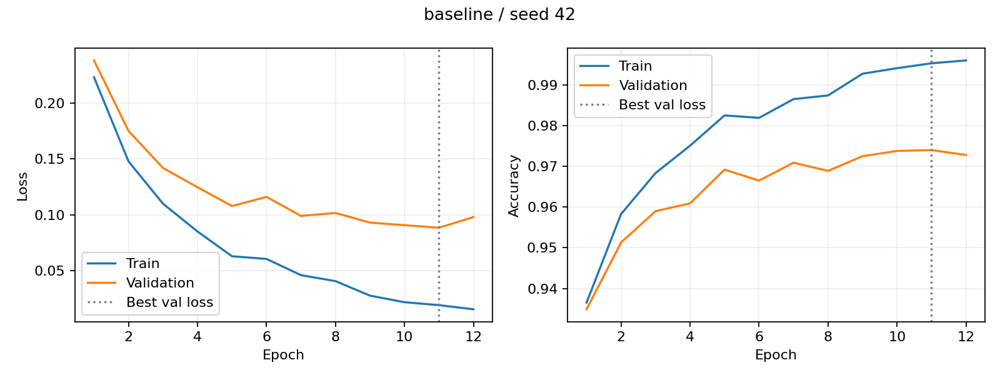
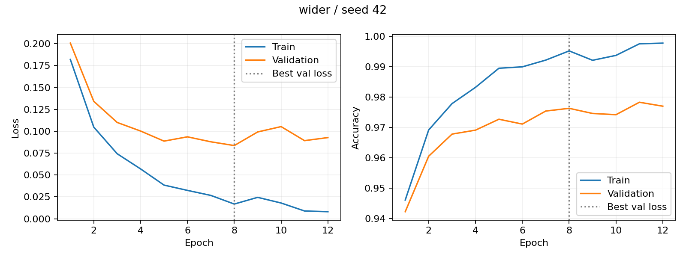
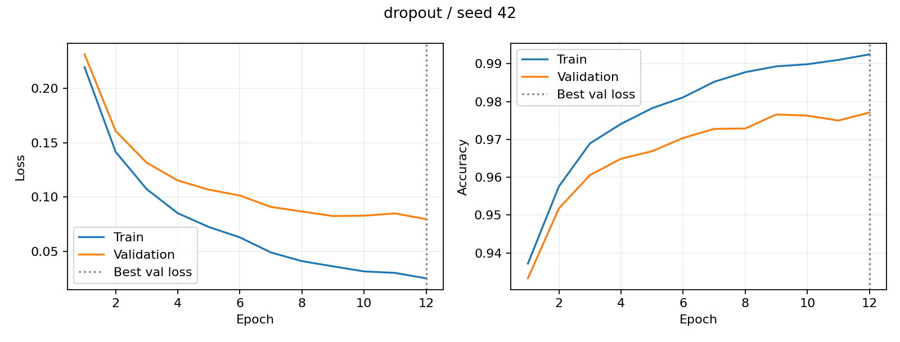
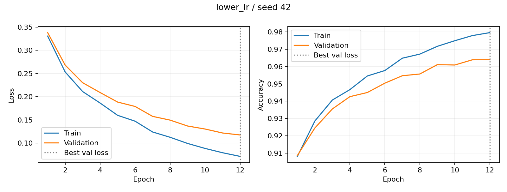
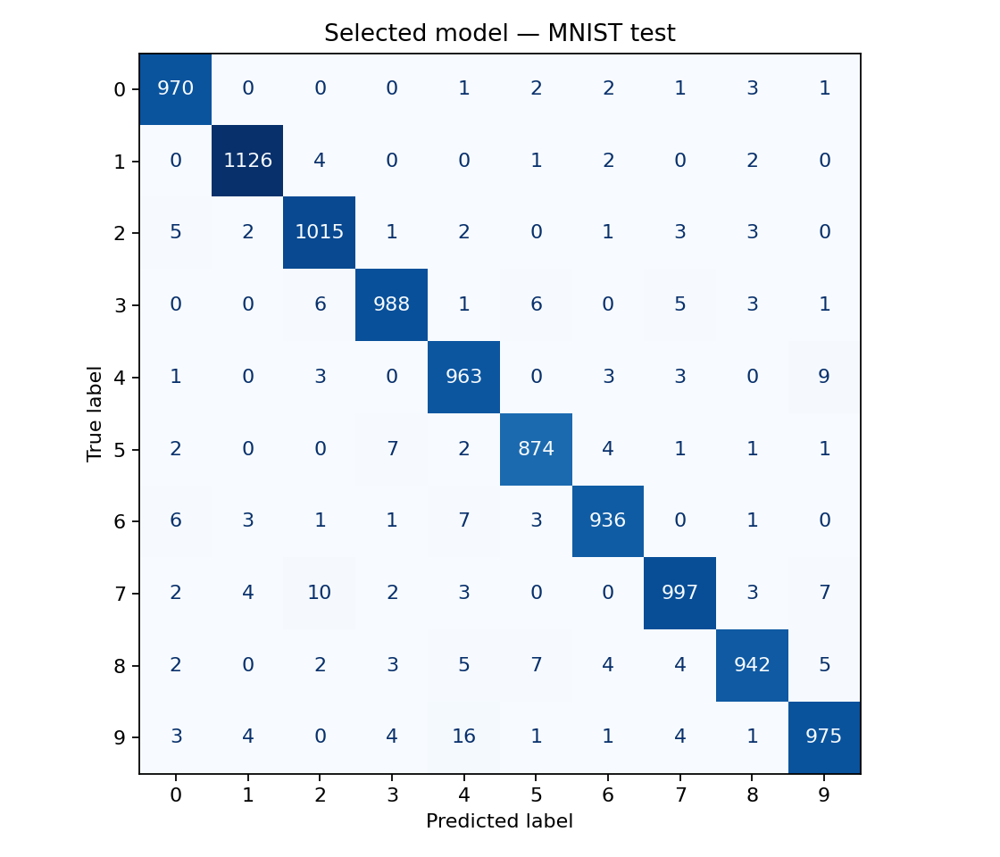
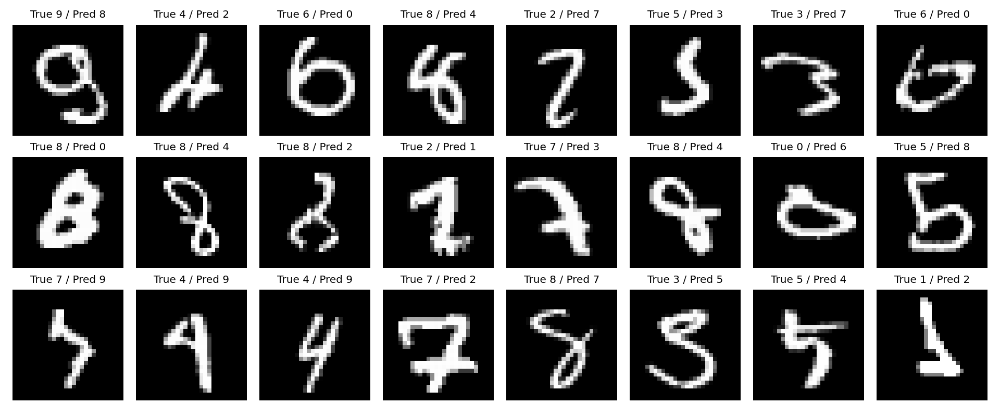
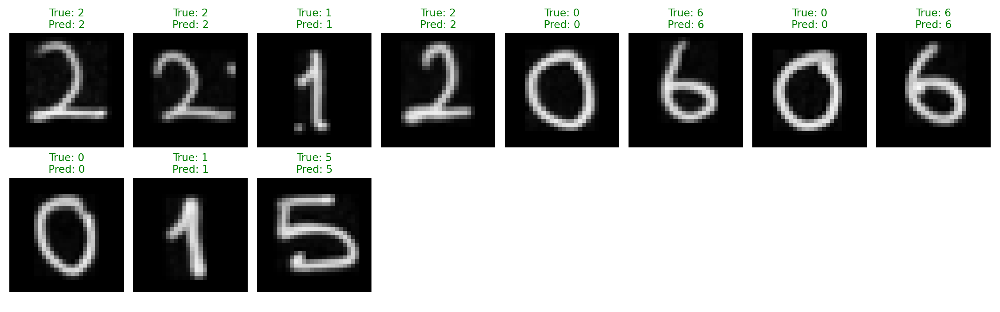

# MNIST ile MLP tabanlı el yazısı rakam tanıma

**Öğrenci:** İrem Nur Sabırlı  
**Öğrenci numarası (görselden okunan):** 22120606015  
**Üniversite:** İstanbul Medeniyet Üniversitesi

## 1. Amaç ve deney tasarımı

Amaç, 28×28 gri tonlamalı görüntüyü 784 özellikli vektöre dönüştüren MLP ile 0–9 sınıflarını tanımak ve yapılandırma değişikliklerini kontrollü karşılaştırmaktır. CNN veya hazır eğitilmiş model kullanılmamıştır. Her deney ve başlangıç için ağırlıklar sıfırdan oluşturulmuştur.

MNIST’in resmî 60.000 eğitim örneği, sınıf oranları korunarak 50.000 train ve 10.000 validation örneğine ayrılmıştır. Resmî 10.000 test örneği ayrı tutulmuştur. Bölme tohumu 42’dir; indeksler `split_indices.npz` dosyasındadır. Tüm modeller aynı bölünmeyi kullanır. Piksel değerleri 255’e bölünerek [0,1] aralığına alınır; veri üzerinden ortalama veya standart sapma öğrenilmez.

## 2. Hiperparametreler

| Deney | Katmanlar | Dropout | Adam öğrenme oranı | Parametre |
|---|---|---:|---:|---:|
| baseline | 784 → 128 → 64 → 10 | 0.0 | 0.001 | 109,386 |
| wider | 784 → 256 → 128 → 10 | 0.0 | 0.001 | 235,146 |
| dropout | 784 → 128 → 64 → 10 | 0.2 | 0.001 | 109,386 |
| lower_lr | 784 → 128 → 64 → 10 | 0.0 | 0.0003 | 109,386 |

Tüm deneylerde ReLU, CrossEntropyLoss, Adam (betas=(0.9, 0.999), eps=1e-8, weight_decay=0), batch_size=128, 12 epoch ve başlangıç tohumları [42, 123, 2026] kullanılmıştır. Scheduler, veri artırma, batch normalization veya erken durdurma uygulanmamıştır. Dropout yalnızca ilgili deneyde her gizli katmandaki ReLU’dan sonra eklenmiştir.

Çıkış katmanı 10 ham skor (logit) üretir. CrossEntropyLoss log-softmax işlemini içerdiği için eğitimde ayrıca softmax uygulanmaz; el yazısı tahmininde skorları göstermek için softmax kullanılır.

Her koşuda en düşük validation loss değerine sahip epoch kaydedilir; eşitlikte ilk epoch korunur. Yapılandırma, üç koşunun bu validation loss değerlerinin ortalaması en düşük olanıdır. Sonra seçilen yapılandırmanın validation loss değeri en düşük tohumu el yazısı için temsilci model olarak alınır. Bu karar `selection.json` dosyasına test dizileri okunmadan önce yazılır. Tüm dondurulmuş modellerin test sonuçları yalnızca nihai karşılaştırma için bir kez hesaplanır; test üzerinden yeni ayar seçilmez.

## 3. Ölçüm tanımları

Accuracy, doğru sınıflandırılan örneklerin toplam örneklere oranıdır. Loss, doğru sınıfa verilen olasılığa ilişkin çapraz entropi kaybıdır; daha düşük olması tercih edilir. Her epoch sonunda train ve validation ölçümleri aynı ağırlıklarla eval modunda yeniden hesaplanır; dropout ölçüm sırasında kapalıdır. Kayıplar örnek sayısıyla ağırlıklandırılmış ortalamadır.

Tablodaki train/validation değerleri son epoch değil, ilgili koşunun en iyi validation loss epoch’una aittir. Eğitim süresi optimizasyonu, epoch sonu train/validation ölçümlerini ve checkpoint yazımını kapsar; veri indirme, grafik çizimi ve test değerlendirmesini kapsamaz. Süreler aynı CPU üzerinde ardışık koşulardan gelir ve donanıma bağlıdır.

## 4. Sonuçlar

Değerler üç başlangıcın ortalaması ± örnek standart sapmasıdır (ddof=1). Accuracy yüzde olarak verilmiştir. Standart sapma güven aralığı değildir.

| Deney | Train loss | Val loss | Train acc % | Val acc % | Test acc % | Süre (s) |
|---|---:|---:|---:|---:|---:|---:|
| baseline | 0.023 ± 0.013 | 0.090 ± 0.003 | 99.377 ± 0.408 | 97.460 ± 0.285 | 97.593 ± 0.156 | 8.790 ± 0.139 |
| wider | 0.016 ± 0.002 | 0.081 ± 0.006 | 99.563 ± 0.043 | 97.687 ± 0.074 | 97.763 ± 0.124 | 14.616 ± 0.452 |
| dropout | 0.027 ± 0.005 | 0.080 ± 0.001 | 99.209 ± 0.148 | 97.653 ± 0.090 | 97.803 ± 0.067 | 10.526 ± 0.402 |
| lower_lr | 0.071 ± 0.002 | 0.116 ± 0.002 | 97.980 ± 0.038 | 96.513 ± 0.121 | 96.923 ± 0.085 | 8.695 ± 0.421 |

### Tüm koşular

| Deney | Seed | En iyi epoch | Train loss | Val loss | Train acc % | Val acc % | Test acc % | Süre (s) |
|---|---:|---:|---:|---:|---:|---:|---:|---:|
| baseline | 42 | 11 | 0.0191 | 0.0884 | 99.53 | 97.40 | 97.57 | 8.94 |
| baseline | 123 | 8 | 0.0374 | 0.0936 | 98.91 | 97.21 | 97.45 | 8.67 |
| baseline | 2026 | 12 | 0.0126 | 0.0869 | 99.68 | 97.77 | 97.76 | 8.75 |
| wider | 42 | 8 | 0.0168 | 0.0836 | 99.52 | 97.63 | 97.83 | 14.82 |
| wider | 123 | 8 | 0.0168 | 0.0862 | 99.56 | 97.66 | 97.62 | 14.93 |
| wider | 2026 | 8 | 0.0141 | 0.0745 | 99.61 | 97.77 | 97.84 | 14.10 |
| dropout | 42 | 12 | 0.0250 | 0.0795 | 99.25 | 97.71 | 97.86 | 10.07 |
| dropout | 123 | 10 | 0.0322 | 0.0809 | 99.05 | 97.55 | 97.73 | 10.70 |
| dropout | 2026 | 12 | 0.0239 | 0.0803 | 99.33 | 97.70 | 97.82 | 10.81 |
| lower_lr | 42 | 12 | 0.0714 | 0.1175 | 97.96 | 96.40 | 97.02 | 9.02 |
| lower_lr | 123 | 12 | 0.0733 | 0.1161 | 97.95 | 96.50 | 96.86 | 8.84 |
| lower_lr | 2026 | 12 | 0.0697 | 0.1135 | 98.02 | 96.64 | 96.89 | 8.22 |

## 5. Model seçimi ve yorum

Validation ölçütüne göre **dropout** seçilmiştir. El yazısı için seçilen checkpoint `dropout_seed42/best.pt` dosyasıdır. Bu modelin test doğruluğu **%97.86**, validation doğruluğu **%97.71** ve en iyi epoch’u **12** olmuştur.

**wider:** Temel modele göre ortalama validation accuracy farkı +0.227 yüzde puanı, validation loss farkı -0.0082 olmuştur. Değiştirilen faktör bu karşılaştırmada tek başına tutulmuştur; sonuç yalnızca kullanılan hiperparametreler ve 12 epoch bütçesi için yorumlanmalıdır.

**dropout:** Temel modele göre ortalama validation accuracy farkı +0.193 yüzde puanı, validation loss farkı -0.0094 olmuştur. Değiştirilen faktör bu karşılaştırmada tek başına tutulmuştur; sonuç yalnızca kullanılan hiperparametreler ve 12 epoch bütçesi için yorumlanmalıdır.

**lower_lr:** Temel modele göre ortalama validation accuracy farkı -0.947 yüzde puanı, validation loss farkı +0.0261 olmuştur. Değiştirilen faktör bu karşılaştırmada tek başına tutulmuştur; sonuç yalnızca kullanılan hiperparametreler ve 12 epoch bütçesi için yorumlanmalıdır.

Geniş ağ daha fazla temsil kapasitesine ve hesaplama maliyetine sahiptir. Dropout eğitimde bazı aktivasyonları rastgele sıfırlayarak düzenlileştirme sağlar; her koşulda daha yüksek accuracy garantilemez. Daha düşük öğrenme oranı aynı epoch bütçesinde daha yavaş yakınsayabilir. Accuracy ve loss aynı yönde değişmek zorunda değildir: doğru/yanlış sınıf kararı değişmeden modelin olasılıkları değişebilir.

Üç başlangıç, başlangıç ağırlıkları ve mini-batch sıralamasından kaynaklanan değişkenliği görünür kılar. Veri bölünmesi sabittir; bu deney çapraz doğrulama değildir ve üç koşu istatistiksel üstünlük iddiası için yeterli değildir. Test sonuçları görüldükten sonra yeni yapılandırma denenerek test kümesine dolaylı uyum sağlanmamıştır.

### Öğrenme eğrileri

Aşağıda her yapılandırmanın seed=42 eğrileri gösterilir. Diğer iki tohumun eğrileri ilgili klasörlerdedir. Dikey çizgi, checkpoint seçiminde kullanılan epoch’u gösterir. Train loss düşerken validation loss artması aşırı öğrenme işaretidir; seçilen checkpoint bu nedenle son epoch’tan daha erken olabilir.

### Seçilen modelin hataları

Karışıklık matrisinde satırlar gerçek, sütunlar tahmin edilen sınıflardır. Köşegen dışındaki sayılar hatalardır. Sınıf bazlı precision, recall ve F1 değerleri `classification_report.json` dosyasındadır.

Görseller test sırasındaki ilk 24 yanlış örnektir; rastgele veya tüm hataları temsil eden bir örneklem değildir. İnceleme yalnızca hata analizi içindir; bu örneklere bakılarak model yeniden ayarlanmamıştır.

## 6. Kendi el yazısı değerlendirmesi

Öğrencinin sağladığı özgün fotoğraf `handwriting/raw/student_number.jpg` dosyasında korunmuştur. Görseldeki numara insan tarafından 22120606015 olarak okunmuş ve gerçek etiketler bu okumadan alınmıştır. Model tahmini etiket oluşturmak için kullanılmamıştır.

Orijinal 1550×779 fotoğraftan soldan sağa 11 dikdörtgen kırpım hazırlanmıştır. Koordinatlar `handwriting/crop_metadata.json` içinde, tekrar üretim kodu `src/prepare_handwriting.py` dosyasındadır. Kırpımlar model çıktıları görülmeden belirlenmiştir. İkinci ve üçüncü kırpımda komşu rakama ait küçük izler görülebilir; bunlar sonuç sonrasında temizlenerek yeniden deneme yapılmamıştır.

Her kırpıma mevcut ön işleme uygulanmıştır: gri tonlama, açık arka planın ters çevrilmesi, arka plan seviyesinin bastırılması, rakam sınırlarının bulunması, oranı korunarak 20×20 alana sığdırma, 28×28 siyah tuvale yerleştirme, kütle merkezine hizalama ve piksel/255 normalizasyonu. Çıktılar `results/handwriting/digit_*_28x28.png` dosyalarındadır.

Görselden okunan numara: **22120606015**. Model tahmini: **22120606015**. Doğru rakam sayısı: **11/11**. Rakam doğruluğu: **%100.00**. Tüm numaranın eşleşmesi: **Evet**.

| Konum | Gerçek | Tahmin | Softmax skoru (%) |
|---|---:|---:|---:|
| 1 | 2 | 2 | 99.99 |
| 2 | 2 | 2 | 87.59 |
| 3 | 1 | 1 | 99.94 |
| 4 | 2 | 2 | 99.74 |
| 5 | 0 | 0 | 99.89 |
| 6 | 6 | 6 | 99.99 |
| 7 | 0 | 0 | 99.98 |
| 8 | 6 | 6 | 99.48 |
| 9 | 0 | 0 | 99.63 |
| 10 | 1 | 1 | 98.90 |
| 11 | 5 | 5 | 99.96 |

Softmax skorları kalibre edilmiş güven olasılığı değildir. En düşük tahmin skoru ikinci rakamda yaklaşık %87,59’dur; bu rakam da doğru tanınmıştır. Görsel farklılıklar veya komşu rakam izi buna katkıda bulunabilir, ancak tek örnek üzerinden neden-sonuç çıkarımı yapılamaz.

MNIST test doğruluğu %97,86 iken bu fotoğrafta 11/11 doğru tahmin elde edilmiştir. El yazısı örneklemi çok küçük ve dengesizdir: yalnızca 0, 1, 2, 5 ve 6 sınıfları vardır; 3, 4, 7, 8 ve 9 sınanmamıştır. Bu nedenle %100 sonucu, modelin gerçek dünyada MNIST’ten daha başarılı olduğunun kanıtı değildir.

Fotoğrafta mavi/mor mürekkep, sıcak tonlu kâğıt, aydınlatma ve kişisel yazım biçimi farklılıkları görülür. Ön işleme bu girdiyi MNIST biçimine yaklaştırmıştır. Bu örnekte dağılım farkı yanlış sınıflandırmaya yol açmamıştır; buna rağmen genel dayanıklılık için daha fazla kişinin farklı koşullarda yazdığı, tüm sınıfları kapsayan bağımsız örnekler gerekir.

Model ve hiperparametreler el yazısı sonucu görüldükten sonra değiştirilmemiştir. Görsel eğitimde veya model seçiminde kullanılmamıştır. Bu sonuç, elle ayrılmış rakamların sınıflandırılmasıdır; otomatik tam sayfa OCR veya otomatik numara bölme başarısı değildir.

## 7. Yeniden üretilebilirlik

Python 3.12.14; PyTorch 2.15.0+cpu; NumPy 2.3.5; aygıt: cpu; thread sayısı: 2. Ortamın ayrıntısı `environment.json` dosyasındadır. Aynı ortamda deterministik işlemler etkinleştirilmiştir; farklı donanım/kütüphane sürümleri birebir aynı sonuçları garanti etmez.

MNIST dosyası SHA-256: `731c5ac602752760c8e48fbffcf8c3b850d9dc2a2aedcf2cc48468fc17b673d1`.

Ham ölçümler `results.json` ve `results.csv` dosyalarında, epoch geçmişleri alt klasörlerde bulunur. Rapor bu kayıtlar üzerinden `python -m src.report --results results/main` komutuyla üretilir.

## 8. Kaynaklar

- [MNIST — TensorFlow Datasets](https://www.tensorflow.org/datasets/catalog/mnist)
- [PyTorch CrossEntropyLoss](https://docs.pytorch.org/docs/stable/generated/torch.nn.CrossEntropyLoss.html)
- [PyTorch Adam](https://docs.pytorch.org/docs/stable/generated/torch.optim.Adam.html)
- [scikit-learn train_test_split](https://scikit-learn.org/stable/modules/generated/sklearn.model_selection.train_test_split.html)

## 9. Genel değerlendirme

Tam bağlantılı MLP ile MNIST sınıflandırması gerçekleştirilmiş, tüm modeller sıfırdan eğitilmiş ve model seçimi validation verisiyle sınırlandırılmıştır. Bu deney düzeninde seçilen dropout yapılandırmasının üç koşudaki ortalama test doğruluğu %97.803 olmuştur. Öğrencinin sağladığı numara fotoğrafındaki 11 rakamın tamamı doğru tanınmıştır. Sonuç tek, küçük örnekleme özgüdür; tüm sınıflarda veya farklı kişilerin el yazılarında genel başarı garantisi değildir.